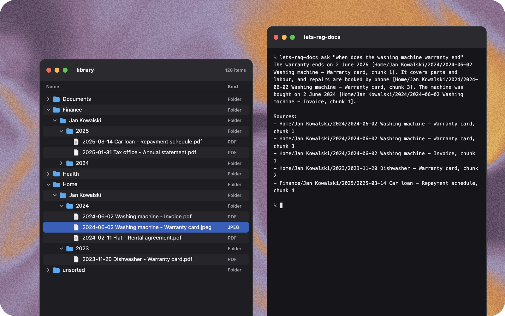

<p align="center">
  
</p>

<p align="center">
  Ask your scanned documents a question and get the passages that answer it, with their source,
  on your own computer.
</p>

<p align="center">
  <a href="#quickstart">quickstart</a> ·
  <a href="#how-it-works">how it works</a> ·
  <a href="#docs">docs</a> ·
  <a href="#private-by-design">privacy</a>
</p>

<p align="center">
  <sub>macOS · MCP server and command line · any local model server · MIT or Apache-2.0</sub>
</p>

<p align="center">
  
</p>

> **Status: early, but the whole path works:** OCR, indexing, hybrid search, retrieval evals, the
> MCP server, `ask` and filing. Install from source for now.

## what it does

- Turns PDFs and photos into searchable text, offline: the PDF's own text, or Apple Vision for
  scans and photos.
- Finds the passages that answer a question, in Polish, English, Russian and Ukrainian.
- Gives any MCP agent a `search_docs` tool that returns passages and the document they came from.
- Answers on its own with `ask`, citing the document behind every claim.
- Files a copy of each document into `library/<folder>/<owner>/<year>/`, named so you can browse
  it by hand. Originals are never touched.

## quickstart

You need a Mac with Docker, Python 3, Rust and a local model server such as
[Ollama](https://ollama.com) (`ollama pull qwen3:30b-a3b`).

```sh
git clone https://github.com/lets-code-apps/lets-rag-docs && cd lets-rag-docs
docker compose up -d
python3 -m venv .venv && .venv/bin/pip install -r requirements.txt && cargo build --release
.venv/bin/python embed_server.py &
target/release/lets-rag-docs add ~/inbox/invoice.pdf
target/release/lets-rag-docs ask "when does the warranty end"
```

Every command, the config, the library and the MCP server are in [guide/USAGE.md](guide/USAGE.md).

## private by design

Your documents, the index, the embeddings and the model all stay on your computer. `ask` refuses a
model address outside your own network unless you switch that check off, and document text is
treated as data, never as instructions.

## how it works

| step | what happens |
|---|---|
| read | the PDF's own text, or Apple Vision for scans and photos |
| index | chunks, bge-m3 dense and sparse embeddings, Qdrant on 127.0.0.1 |
| find | hybrid search, then passages with the document they came from |
| answer | your agent through MCP `search_docs`, or a local model through `ask` |

## docs

| read | for |
|---|---|
| [guide/USAGE.md](guide/USAGE.md) | setup, every command, the library, the MCP server, evals, roadmap |
| [config.example.toml](config.example.toml) | every setting, with its default |
| [guide/MODEL.md](guide/MODEL.md) | the model both Let's Code apps share, and which one each app uses |

## contributing and licence

Contributions are welcome: open an issue or a pull request.

Licensed under either of [Apache License, Version 2.0](LICENSE-APACHE) or [MIT license](LICENSE-MIT)
at your option. Unless you explicitly state otherwise, any contribution intentionally submitted for
inclusion in this project by you, as defined in the Apache-2.0 license, shall be dual licensed as
above, without any additional terms or conditions.

<br>

<p align="center">
  <a href="https://lets-code.pl">
    <picture>
      <source media="(prefers-color-scheme: dark)" srcset="assets/readme/lets-code-white.svg">
      
    </picture>
  </a>
</p>

<p align="center">
  <sub>made by <a href="https://lets-code.pl">let's code</a> · local apps, your data stays on your computer<br>
  also: <a href="https://github.com/lets-code-apps/lets-triage-mail">let's triage mail</a></sub>
</p>
